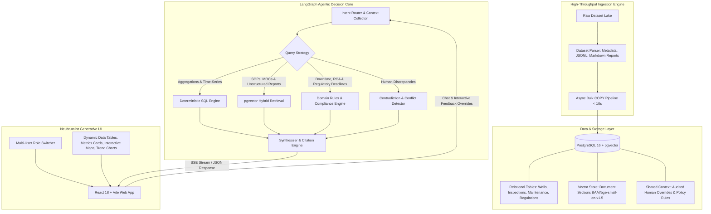

# Asset Intelligence Copilot
### Autonomous Agentic AI Copilot for Onshore Oilfield Operations
---

## 1. Executive Summary

In onshore oilfield operations, hundreds of artificial-lift wells operate across vast geographic blocks. Field teams manage high-velocity, multi-modal data streams:
- **Weekly visual and thermal inspection logs** (drone and manual ground readings)
- **Time-series maintenance records and work orders**
- **Unstructured narrative repair reports and root-cause analyses (RCAs)**
- **Regulatory filings, notices of violation (NOVs), and environmental penalties**
- **Informal field operator logs, shift observations, and planned workovers**
- **Technical well operating manuals and environmental Standard Operating Procedures (SOPs)**

The **Asset Intelligence Copilot** is a production-grade, autonomous decision-support system designed to solve complex operational, compliance, and engineering queries in seconds. It bridges structured sensor metrics and unstructured field narratives using a hybrid relational/vector engine, dynamic physical domain calculations, multi-turn memory isolation, and a Neubrutalist Generative UI.

---

## 2. System Architecture



---

## 3. Core Domain Rules & Calculation Logic

The copilot implements physical, mathematical, and regulatory domain truth:

| Domain Principle | Governing Document & Operational Rule | Implementation Logic |
| :--- | :--- | :--- |
| **Well Producing State** | Reservoir fluid is warmer than ambient air; idle wellheads cool to ambient. Absolute wellhead temp does **not** determine production. | **T200 Wells:** $\Delta T = T_{wellhead} - T_{ambient} \ge 15.0^\circ\text{C}$<br>**T350 Wells:** $\Delta T = T_{wellhead} - T_{ambient} \ge 20.0^\circ\text{C}$<br>**T500 Wells (ESP):** $\Delta T = T_{wellhead} - T_{ambient} \ge 25.0^\circ\text{C}$<br>*Evaluated dynamically against the well's active `type_history` on the inspection date.* |
| **Operational Downtime** | Measured strictly by weekly inspections. Missed inspections add 0 downtime. | **Each non-producing weekly inspection = 7 days downtime.** Repair job durations (`maintenance.downtime_hours`) are never conflated with well downtime. |
| **Stale Record Detection** | `metadata.json` (`recorded_status`) is updated periodically, while inspections occur weekly. | **Weekly inspection thermal $\Delta T$ is ground truth.** Discrepancies between physical temperature state and `recorded_status` are flagged as stale. |
| **Spill Compliance (SR-01, SR-02, SR-03)** | State Environmental & Spill Response SOP (`SOP-SR`). Discovery time = inspection timestamp. | - **Minor (< 1 bbl):** Clean up, no filing required.<br>- **Moderate (1 to < 5 bbl):** Clean up, internal HSE notification within 72h.<br>- **Reportable (5 to < 25 bbl):** Agency report within **24 hours** (SR-01); contained within **4 hours** (SR-02); remediated to $\le 1.0\%$ TPH verified within **60 days** (SR-03).<br>- **Major ($\ge 25$ bbl):** Agency notice within **2 hours**.<br>- **Emergency Pad Shut-in:** Any spill covering $> 5\%$ of pad area triggers immediate well shut-in. |
| **Root-Cause Analysis (RCA)** | Well Operating Manuals Section 10 & MOCs. | **Standard:** $\ge 3$ corrective repairs on the same equipment kind within 12 months require an RCA.<br>**T500 ESP Wells:** $\ge 2$ corrective repairs on `esp_pump` within 12 months.<br>Dynamic policy overrides in `shared_context` take precedence over manual defaults. |
| **Conflict & Discrepancy Resolution** | Human corrections vs. inspector observations vs. conflicting operator statements. | **The copilot never silently picks a side.** Both claims are surfaced with citations, contradictions highlighted (e.g. inspector note *"Pump jack not moving"* vs thermal gun correction), and confirmation requested. |
| **Memory Isolation & Shared Knowledge** | Private conversations vs. operational broadcasts. | Multi-user conversation memory is isolated by `(user_id, session_id)`. Broadcasts (e.g. *"WELL-0007 will be shut in from 17 Oct"*) propagate fleet-wide via `shared_context` with validity windows (`valid_from`, `valid_to`). |

---

## 4. Dataset Repository & Management

The raw datasets for this platform are hosted on GitHub:
👉 **[FlytBase Asset Intelligence Dataset Repository](https://github.com/FlytBaseAILabs/flytbase-ahc-swe-asset-intelligence-dataset)**

> [!IMPORTANT]
> **Data Decoupling Principle:** Raw data lakes (JSONL files, evidence images, and well folders) are strictly decoupled from the application source code and excluded via `.gitignore` to prevent repository bloat and ensure fast deployments.

The ingestion pipeline can load any compatible dataset directory (sample data or the 600-well test dataset) into PostgreSQL in **under 10 seconds** using native asyncpg binary bulk COPY.

---

## 5. Quickstart & Installation

### Prerequisites
- [Docker](https://www.docker.com/) & Docker Compose
- [Python 3.11+](https://www.python.org/) and [`uv`](https://docs.astral.sh/uv/)
- [Node.js 18+](https://nodejs.org/) & npm

### Step 1: Start PostgreSQL with pgvector
```bash
docker-compose up -d
```
*Starts PostgreSQL 16 with `pgvector` on port `5433` (database: `asset_copilot`).*

### Step 2: Configure Environment Variables
Copy the template and provide your API keys:
```bash
cp .env.example .env
```
Edit `.env`:
```env
POSTGRES_USER=postgres
POSTGRES_PASSWORD=postgres
POSTGRES_DB=asset_copilot
POSTGRES_HOST=localhost
POSTGRES_PORT=5433

OPEN_ROUTER_API_KEY=your_openrouter_api_key_here
GEMINI_API_KEY=your_gemini_api_key_here
PRIMARY_MODEL=openrouter/google/gemma-4-26b-a4b-it
FALLBACK_MODEL=openrouter/google/gemma-4-31b-it
```

### Step 3: Ingest Data
Clone or download the dataset from the [official dataset repository](https://github.com/FlytBaseAILabs/flytbase-ahc-swe-asset-intelligence-dataset), then run:
```bash
uv run python -m src.ingestion.pipeline --data-dir test-data/dataset
```
*Ingests 600 wells, 125,000+ inspections, 17,000+ maintenance events, and generates 4,500+ dense vector embeddings.*

### Step 4: Launch Backend API
```bash
uv run python -m uvicorn src.api.main:app --port 8000 --reload
```
- API Documentation: `http://localhost:8000/docs`
- Health Endpoint: `http://localhost:8000/api/health`

### Step 5: Launch Frontend UI
```bash
cd frontend
npm install
npm run dev
```
- Open `http://localhost:5173` in your browser.

---

## 6. Project Directory Layout

```
asset-copilot/
├── docker-compose.yml           # PostgreSQL 16 + pgvector container definition
├── pyproject.toml               # Python dependencies and packaging (uv)
├── .env.example                 # Environment variables template
├── SYSTEM_DESIGN_SSOT.md        # Architecture & System Design Single Source of Truth
├── src/
│   ├── config.py                # Pydantic Settings & environment config
│   ├── db/
│   │   ├── schema.sql           # Complete relational + vector DDL schema
│   │   └── connection.py        # Asyncpg and SQLAlchemy async session management
│   ├── ingestion/
│   │   ├── parser.py            # High-performance parser (wells, JSONL, reports, manuals)
│   │   └── pipeline.py          # Asynchronous high-throughput bulk ingestion pipeline
│   ├── analytics/
│   │   ├── domain_queries.py    # Thermal physics, downtime sums, and status queries
│   │   ├── compliance_queries.py# Environmental deadlines (SR-01/02/03) & RCA triggers
│   │   ├── spill_queries.py     # Spill volume classifications & spatial filtering
│   │   └── conflict_detector.py # Contradiction & discrepancy detection engine
│   ├── retrieval/
│   │   ├── embeddings.py        # FastEmbed BAAI/bge-small-en-v1.5 dense vector generator
│   │   └── vector_store.py      # Hybrid semantic + metadata filtering vector search
│   ├── memory/
│   │   ├── session_store.py     # Isolated multi-turn user conversation state
│   │   └── shared_context.py    # Audited human overrides, broadcasts & policy rules
│   ├── agent/
│   │   ├── graph.py             # LangGraph StateGraph orchestration
│   │   ├── tools.py             # Specialized tool registry for LLM invocation
│   │   ├── prompts.py           # Domain system prompt & few-shot instructions
│   │   └── state.py             # Typed state schema for agent turns & generative UI
│   └── api/
│       ├── main.py              # FastAPI endpoints (chat SSE, users, health, overrides)
│       └── schemas.py           # Pydantic models for API requests and UI payloads
├── frontend/
│   ├── src/
│   │   ├── components/
│   │   │   ├── chat/            # Chat interface, user switcher, citation drawer
│   │   │   └── widgets/         # Dynamic DataTables, MetricCards, Interactive Geo Maps
│   │   └── App.tsx              # Neubrutalism UI application root
└── tests/
    ├── phase1/                  # Ingestion & deterministic SQL unit tests
    ├── phase2/                  # Tool calling & compliance query tests
    ├── phase3/                  # Memory isolation & conflict resolution tests
    └── phase4/                  # End-to-end integration & evaluation suites
```

---

## 7. Automated Testing & Verification

Run the comprehensive test suite across all 4 operational phases:
```bash
uv run pytest tests/ -v
```

---

## 8. License

Developed for the FlytBase Hackathon. Released under the [MIT License](LICENSE).
